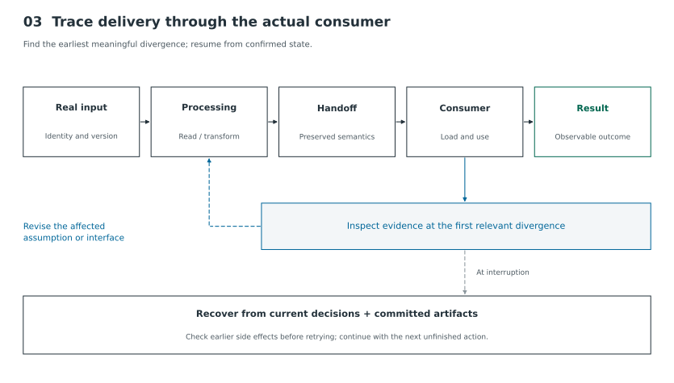

# How I Organize Work with AI Agents

[中文](README.md) · [Worked example](docs/worked-example.en.md) · [References](docs/references.md) · [Figures](figures/README.md)

After opening several AI conversations at once, I found myself getting busier.

One conversation needed background. Another needed a progress check. I had to carry A's output over to B, then help B find the right file. A tool we had already built would get built again in a fresh conversation. Some tasks were marked complete, only for a missing step to turn up when I tried to use the result.

I started moving useful information out of chat: where a project stood, how to call an existing tool, which discoveries might help next time. Over time, I added ways to divide work, pick it up in another conversation, and maintain the tools. That became the workflow described here.

It is still changing. Parts of it can help with research, development, creative work, learning, or organizing information. The arrangement depends on the job. I'll start with how I keep the material, then follow a task through the rest of the process.

## 1. Some things need a home outside chat

A conversation can hold plenty of detail. Finding the relevant exchange later is another matter. Keeping track of it all becomes tiring as projects accumulate.

I keep the things I often need in a few places:

| Where | What goes there | When it helps |
|---|---|---|
| Working rules | Shared requirements about permission, privacy, and honest reporting | Keep these short because they apply across tasks |
| Knowledge library | Facts, sources, parameter explanations, and lessons from failures | Look up the relevant material when investigating a problem |
| Skills | Methods that have proved useful across repeated tasks | Read the relevant procedure when it is needed |
| Tool registry | Available tools, their entry points, invocation, and limitations | Check whether a useful capability already exists |
| Project record | Current progress, decisions, files, and remaining work | Resume after a break or hand work to another conversation |
| Project and scratch directories | Working files, experiments, and intermediate output | Use during the task and tidy up afterward |

A project record can be brief. It needs to say what we're doing, where we've got to, where the files are, and what comes next. A small task may only need a few sentences.

*These are places for different kinds of information. Folders and Markdown are enough to start.*

This makes updates easier. When a tool's invocation changes, update its entry. A project decision belongs with the project. A confirmed discovery about a format goes in the knowledge library. Keep the full explanation in one place and link to it elsewhere, or the copies will eventually disagree.

Skills deserve the same restraint. A long debugging session does not automatically warrant a procedure that every future agent has to read.

I usually give a conversation the relevant entry points first and let it open the details as needed. OpenAI's writing on repository knowledge and Anthropic's work on context management describe related approaches.[1–3](docs/references.md#s01)

## 2. The solution I suggest may be a detour

When I ask for something, I can often describe the result I want and suggest a technique I've heard of. I might ask for a vector database because I want my documents to be easier to search. I may not know whether one is needed.

I want the agent to examine what we have and help work out the approach: what the documents look like, how I search them, how much existing tools can do, and where I'll use the result.

Full-text search might cover most queries. If real use turns up cases where similar meanings use different words, we can compare semantic search. If my suggestion takes the long way around, explain why and use a better approach.

This needn't produce a planning document for every task. Small jobs can proceed directly. A more involved one may need a sketch or a few paragraphs explaining the design for whoever comes next. Changes to the goal, privacy decisions, spending, and actions that are hard to undo need my input.

The agent can also discover missing pieces as it works. Earlier ideas remain useful background, and can change when the actual task proves them wrong.

## 3. Look for something we can use before building

Before implementation, I ask the agent to check local tools and records, then relevant public projects, documentation, or papers. Start work once there is enough information to choose an approach.

A promising project still needs a closer look: what does it accept, what does it produce, which versions does it support, and can its output go where we need it? A polished demo can be an expensive dependency if integrating it means rewriting most of it.

Sometimes we can use a whole library. Sometimes one module is enough, or the idea alone is useful. Replace the parts that do not fit. It makes little sense to keep changing our goal to accommodate a reference project.

A good repository can lead to more useful material through its dependencies, issues, author's other work, and related papers. Stars and bookmarks help find leads. Trying our own input tells us whether a lead is useful.

The same applies locally. If the registry search misses something, look in the code, try different words, or browse the directories. A capability may exist under a name nobody thought to search for.

## 4. Divide work without making me forward everything

I'd like one main conversation to keep track of the project: understand the request, assign work, collect results, and bring the pieces together. Detailed work can go elsewhere, with important decisions and current progress kept somewhere we can find them.

Two independent tasks can run together. If one needs an interface from the other, settle that interface first. Those dependencies largely determine how to divide the work.

*Blue arrows show assignments and feedback. Dashed lines show communication between workers. The number of workers is illustrative.*

A task description should be enough to begin: what to do, where the input is, what can change, what to deliver, and how to judge whether it works. Add known pitfalls and things that must be left alone. The worker can choose different search terms, samples, or candidate solutions.

Workers can discuss an interface directly and record the resulting decision. An investigation should return files or entry points that the next person can use. That saves me from explaining the handoff again.

Extra conversations can also make a job harder. Several agents changing one file or using the same editor can create a mess. Worktrees separate code changes, while databases, browsers, GPUs, and application state still need their own arrangements. Some work simply needs to happen in sequence.

Subagents are useful for investigating a question, trying another approach, or making a fairly independent change. A long-running module can keep its own conversation. A small job can stay with one agent. Official examples and multi-agent research offer useful discussion of both the gains and coordination costs.[7–10](docs/references.md#s07)

## 5. Make the next conversation easier to start

A successor needs to know where things stand. Usually that means the current goal, usable files, the reason for the chosen approach, unresolved work, and a concrete next action.

For example:

> Search results are connected to the page and open the original text. This delivery links the changes and run instructions. Attachments and automatic updates are still pending. Next, use the existing refresh feature to try reindexing after one file changes. An earlier position format opened the wrong line; the corresponding record explains why.

The real note needs real links. Start by checking the files and what is currently running, then consult relevant history if they disagree. Keep useful earlier findings and the reasons for abandoned approaches, so that the next conversation can avoid repeating them.

There is also the problem of a message being sent and nothing happening afterward. More written conventions won't fix that on their own. Ongoing dispatch needs software that tracks receipt, execution, output, and integration. After an interruption, it needs to find out how far the previous attempt got before retrying.

Existing state services, execution interfaces, and orchestration projects can help. ADK, LangGraph, and Codex app-server are worth examining for a specific need. Recovery and retries still have to be tried on our own tasks after connecting them.[11–15](docs/references.md#s11)

## 6. Keep the useful work when changing tools

I use different agent tools. Codex, Claude Code, and Antigravity can each be an entry point. The word *harness* sometimes appears in this discussion: it means the software managing context, tool calls, permissions, and execution.

Goals, established facts, tool instructions, procedures, and file locations can live outside any one tool. Bringing those into a new environment saves a lot of background explanation.

Execution needs separate setup. Reading rules, connecting tools, assigning tasks, waiting for results, and controlling local applications work differently across environments. After copying files, check what the current conversation actually loaded and can call.

Agent Skills, MCP, and ACP cover some of the formats and interfaces, and are useful where they fit.[4–6](docs/references.md#s04) My main concern is being able to find and use earlier work after changing tools. Automatic teams and ongoing scheduling across environments still need dedicated implementation.

## 7. A tool's empty result should leave room to investigate

As the tool collection grows, one failure worries me: a tool fails to read something, and the agent concludes it doesn't exist.

A search can return nothing because there was no match, the wrong directory was selected, a format was unsupported, or part of the input never loaded. An empty list alone makes those cases hard to distinguish.

A tool should make it possible to see what it examined, what it read, what failed, and the original error. The agent can then try another tool, inspect the file, or fix the invocation. It should also be able to overturn the tool's interpretation.

Success needs similar care. Getting a request accepted, writing a file, loading it in an application, and getting the right result are separate steps.

I want tools to save repetitive work: indexing, parsing, converting, batch operations, and application control. The agent can handle straightforward judgments itself. A tool is worth maintaining when it saves effort, prevents meaningful errors, or handles a changing interface we keep needing.

## 8. Try the result where it will be used

Several tasks can be marked complete while their combined result still fails. The later this becomes visible, the more work may need to be redone.

I prefer to take a real input through the whole process early. For search, enter a term, see the result, and open the correct original. For a conversion, load the output in the program that will use it next.

*Trace a problem back to the first point where things went wrong. The return to processing shown here is one example.*

Once the file opens, check what happened to its contents. Do names still identify the right objects? Are units, orientation, and timing correct? Did the next step lose information it needs? Follow the problem through reading, processing, transfer, and loading before adding compensation at the end.

After the first path works, keep the rest of the goal in view. Try another input, reopen the application, or test an update. Choose a variation likely to reveal a new problem.

A second input is particularly helpful when building something reusable. It shows which parts are shared and which assumptions happened to hold for the first case. A difference may call for an adapter, a replacement module, or a change to the core. Identify the affected parts and check them.

## 9. The workflow needs tidying too

Rules accumulate easily. A problem leads to a rule, then another problem leads to another. Eventually, preparing to work can become more complicated than the work itself.

I revisit them: what does this rule still prevent? If the tool has been fixed, is the old reminder useful? Are two procedures doing the same thing? Some structure was compensating for limitations in an earlier model and deserves another look as models improve. Anthropic's later harness experiments also discuss removing practices that were no longer helping.[16](docs/references.md#s16)

Checks should fit the job. Run a check that answers the relevant question, then continue. An important design or public release may deserve an independent review. For visual work and interaction, I need to see the actual result. Repeatedly confirming that a file exists adds little.

To try this approach, start with one project that keeps requiring explanations. Leave clear links to the current files and next action, then document one tool you often have to find again. Add more when it helps. If ongoing scheduling becomes necessary, look at existing projects such as AO and Vibe Kanban and work out which part they could handle.[14–15](docs/references.md#s14)

We still miss updates, misunderstand things, duplicate work, and run into trouble sharing application state. There is more to improve. I look for practical signs of progress: fewer messages to forward, less background to repeat, and more earlier work that we can use again.

## Further reading

- [A worked example: search in a local document browser](docs/worked-example.en.md)
- [References and what informed this workflow](docs/references.md)
- [Figure downloads and rendering instructions](figures/README.md)

The article, original figures, and examples use [CC BY 4.0](LICENSE). Referenced third-party material retains its own terms. Examples have been abstracted. This is a personal account of practice, without a controlled comparison of productivity across platforms.
