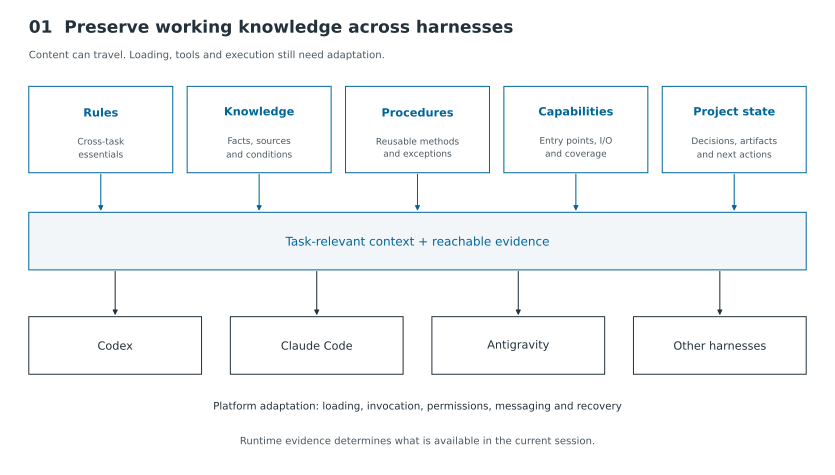
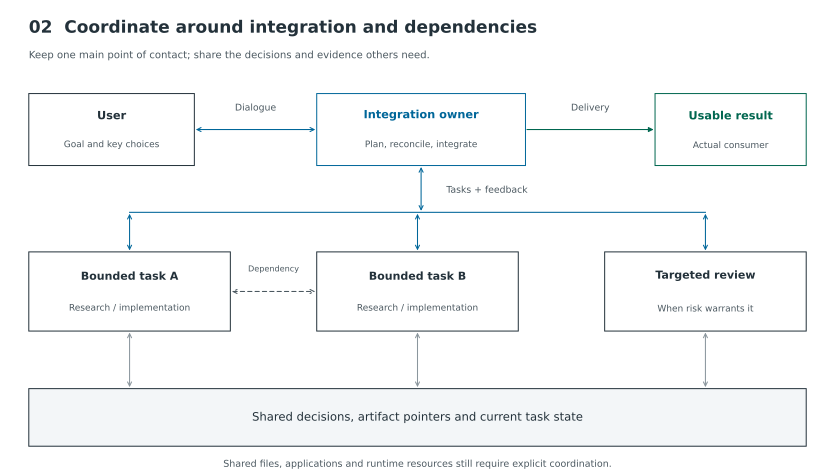

# Organizing a Local Agent Workflow

**How knowledge, skills, tools, and project records support long-running work, multi-agent collaboration, and continuity across environments.**

[中文完整文章](README.md) · [Worked example](docs/worked-example.en.md) · [References](docs/references.md) · [Figures and reproduction](figures/README.md)

When AI moves from one-off questions to ongoing work, the problems change. The model still needs to understand a request and exercise judgment, but the project begins to depend on information outside the conversation: why a particular approach was chosen, which parts existing tools can handle, what other contributors have delivered, and which results are already in use.

If this information stays in chat, the user gradually takes on the coordination work: supplying background, forwarding tasks, locating outputs, and explaining version differences. Adding agents can increase that burden.

This article describes an evolving local workflow that manages reusable knowledge, procedures, tool capabilities, and project state separately, then brings them together for a specific task. These practices have been used in UE projects, game development, and tool development. Research, creative work, learning, and document processing can also adopt relevant parts of the approach, with completion criteria appropriate to each setting.

The focus is how work is organized, how information is maintained, and how results are handed over. Examples have been generalized and disclose no internal projects, tool implementations, or private material. This is a practice report: public research informs the design choices, but the article reports no cross-platform productivity measurements and does not present unimplemented scheduling features as existing capabilities.

## 1. Design goals: preserve information across the work

A single conversation can often complete a task using its current context. A long-running project repeatedly crosses boundaries: from request to implementation, from one contributor to another, from one session to the next, and from generated output to actual use. Information can be lost at each transition.

The missing information is often a fact that changes a decision. A successor may see the current plan without knowing which input version it assumes. A tool may return no matches without reporting inputs it failed to parse. Two modules may pass their own tests yet disagree about the meaning of a shared field when integrated.

The workflow therefore addresses three problems:

- **Recovering the basis for decisions.** Important conclusions should lead back to sources, inputs, or actual outputs. Summaries should preserve a route to that evidence.
- **Connecting responsibility and state.** Contributors need to know what to deliver and who will receive it. Successors need to distinguish work that has taken effect from work still to be done.
- **Keeping existing capabilities usable.** Tools, procedures, and knowledge should remain identifiable and accessible beyond the conversation in which they were created.

These goals do not require a uniform process. A small task that one agent can complete should stay small. Add records and coordination when continuity, shared changes, or repeated implementation create a real need. The process should be proportionate to the information loss and coordination cost it addresses.[19](docs/references.md#s19)

## 2. Library structure: separate responsibilities and update cycles

The important feature of the library is that each kind of information has a clear place to be maintained. General rules, domain knowledge, procedures, and project state change at different rates. Mixing them creates two recurring problems: temporary conclusions become permanent requirements, while information that needs updating spreads across competing copies.

| Component | Responsibility | Typical reason to update |
|---|---|---|
| General rules | Cross-task requirements for authorization, privacy, factual reporting, and shared changes | A working boundary or lasting collaboration principle changes |
| Knowledge base | Sourced facts, format and parameter descriptions, conditions of use, cases, and failure explanations | New evidence arrives, or a version change affects an earlier conclusion |
| Skills | Reusable methods, important judgments, and necessary operations | A method improves or an older procedure no longer applies |
| Tool registry | Function, invocation, inputs and outputs, dependencies, supported scope, and known limitations | A tool is added, an interface changes, or observed behavior differs from its record |
| Project records | Current goals, decisions, output locations, unfinished work, and next actions | Project state changes in a way that affects continuation |
| Project workspace | Implementations, source files, experiments, runtime data, and deliverables | Ordinary development and experimentation |

References connect these components. A project record points to the current deliverable; a tool entry points to its implementation and usage documentation; a skill refers to relevant domain knowledge. Shared material has one maintained home, while other entry points provide the context and links needed to reach it. This reduces the chance of copies evolving independently.

*Figure 1. The library holds maintained working information. Each conversation selects what it needs, while the execution environment handles loading and invocation.*

Information can move between these locations as its value becomes clearer. Troubleshooting begins in the project. A confirmed format property may belong in the knowledge base; a repeatedly useful method may become a skill; an extracted component may receive a tool entry. The original experiment remains in the project for further inspection. This allows experience to accumulate without turning every task into a library-wide documentation exercise.

As the library grows, context selection becomes important. A session starts with relevant entry points and current state, then opens underlying evidence when needed. Summaries help navigation; they cannot replace the material they summarize. OpenAI's repository-knowledge practices and Anthropic's discussions of retrieval, compaction, and external notes provide useful comparisons for this approach.[1–3](docs/references.md#s01)

Selective loading can still miss relevant information. Entries need useful descriptions, and agents should be able to continue through synonyms, references, and code search. A registry query that finds nothing establishes only that the query found nothing. It does not establish that the capability is absent.

## 3. From request to design: establish the intended use before choosing an implementation

Users often combine a goal with an initial technical suggestion: “Make these documents easier to search; perhaps we need a vector database.” Easier retrieval is the goal. A vector database is one candidate implementation. An agent needs to distinguish them and assess the suggestion against the actual conditions.

Useful analysis explains the full relationship: what inputs exist, what processing is needed, where the result will be used, and which conditions affect the choice of implementation. For local document search, file types, query habits, update frequency, source navigation, and privacy requirements may determine the architecture before the choice of database does.

Research into existing solutions should follow these decisions. Local registries, native application features, public libraries, documentation, and papers can all offer reusable parts. Candidates need to be checked for actual inputs and outputs, version support, downstream integration, and maintenance cost. Where necessary, representative inputs can test a critical assumption. Implementation begins once the evidence is sufficient to choose a route.

Reuse has several forms. A project may call a mature component directly, use only its parser or data structures, or adopt an interaction technique. If a reference project does not fit the goal, identify the gap and choose adaptation, replacement, or a new implementation. Any savings from existing code need to be assessed alongside the constraints it introduces.

Research need not stop at keyword search. A useful implementation often leads to upstream dependencies, related issues, other work by its author, and cited papers. Following these relationships can reveal capabilities described under different names. Popularity and bookmarks are leads, not evidence of suitability.

Once a design is clear, record what later work depends on: the main structure, shared interfaces, important choices and their reasons, and assumptions still to be tested. A small change may need only an implementation and a short explanation. The user retains control over goals, authorization, and major commitments. Reversible technical choices within scope remain with the implementer and can change as evidence develops.

## 4. Multi-agent collaboration: divide by dependency and assign integration responsibility

The benefit of multiple agents depends on how much work can proceed independently and how expensive it is to combine the results. Independent research, investigation of different hypotheses, and changes in separate areas are often suitable for parallel work. Repeated edits to the same interface or concurrent use of one stateful application can instead create waiting and rework.

A complex project can use a main coordination point responsible for delivery and integration. This role maintains goals, important dependencies, and shared decisions, and brings completed contributions into the working result. Implementation details remain with the relevant tasks and outputs. Users can still speak directly to contributors, and contributors can discuss concrete dependencies with one another, recording changes that affect the wider project.

*Figure 2. Keep goals and integration responsibility coordinated while distributing exploration and implementation by dependency. Team size and communication links are illustrative.*

A task assignment should provide enough information to start independently: the goal, real inputs, permitted changes, expected output, completion criteria, and delivery location. Add constraints for shared interfaces, privacy, and budget as needed. The delegator's search history, samples, and candidate methods remain evidence that the implementer can revise in light of new findings.

The collaboration format should also fit the duration of the work. Subagents suit bounded tasks whose results can be collected. Long-lived modules may benefit from their own conversations and workspaces. Both need an identified recipient for the deliverable; otherwise, a contributor can finish without anyone taking responsibility for integration.

Separating file changes addresses only one source of interference. Independent worktrees isolate code edits, but databases, indexes, browser sessions, editors, GPUs, and output directories may still be shared. Their concurrency behavior needs to be checked. Resources that cannot safely be shared need an owner or an execution order.

External examples support choosing collaboration according to task structure. Anthropic's research system and Codex subagents illustrate delegation and context separation. MAST and research on scaling agent systems examine failures in coordination, alignment, and verification. Gains in research workloads cannot simply be transferred to tightly coupled engineering projects; adoption still requires observation of the actual workload.[7–10](docs/references.md#s07)

## 5. Tool design: interpretable results and failures that remain open to investigation

Tools are useful for deterministic processing, repeated operations, batch work, and control of external applications. Whether a capability deserves a tool depends on whether it removes real repetition, isolates a changing interface, or reduces an important source of error. A one-off judgment the model can already make rarely needs another wrapper.

Existing capabilities should be reused at a level that can be called independently. Add an interface when it provides a concrete integration benefit. For example, a stable parsing core can serve both a command-line interface and MCP. That does not require combining every tool into one platform.

Ambiguous results are a particular concern. The same empty response can conceal very different outcomes:

| Actual outcome | What the caller needs to know |
|---|---|
| No match in the processed scope | What was processed and searched, and under which conditions |
| Only part of the input was processed | Coverage, reasons for exclusions, and where to inspect further |
| Execution failed | The failing stage, useful diagnostics, and the underlying error |
| A request was submitted and is still running | Current state and how to wait for or retrieve the result |
| Output was generated | Its location and version, with downstream loading marked unverified if it was not checked |

These are distinctions to preserve, not a mandatory return schema. A simple tool can explain them in text. An interface used for batch processing can provide appropriate structured fields.

Negative conclusions deserve particular care. An unsupported format, an incorrect search root, or data that has not loaded can all produce false negatives. The agent should be able to inspect the original input, invocation parameters, and errors, use another method, and, where necessary, reject the tool's interpretation. A tool should make more of the operation observable so the model can judge the scope of the result.

People and agents should use the same functional semantics wherever practical: the same input scope, the same meaning for options, and corresponding outputs. Machine interfaces can be more structured without quietly changing what an operation means.

## 6. Delivery and verification: follow real input through actual use

Module tests establish local behavior. The complete usage path needs its own check. A converter can successfully write a file that a downstream application misinterprets because of identifiers, encoding, units, coordinates, or timing. Document, retrieval, and creative tasks have analogous problems: once content is generated, a reader or application still needs to use it as intended.

Early in a project, choose a real path that exercises the important new dependencies and connect input, processing, handoff, and use. This exposes interface mismatches and misunderstandings before large-scale production.

*Figure 3. Check the path through the result in use. Diagnosis may return to input, processing, handoff, or use; recovery first establishes which operations have already taken effect.*

When a result is wrong, compare the stages along the dependency path to locate the first relevant divergence. Then correct the affected assumption, data, or implementation. Repeating the final operation rarely fixes a semantic error upstream.

The first working path demonstrates feasibility, not completion of the whole goal. Later checks should introduce differences that could change the conclusion: another input type, a different scale, updated data, reopening, or recovery after interruption. The need for independent review, full regression, or human observation depends on consequences and uncertainty.

These variations also test the limits of reuse. A second object may require only different data, or it may reveal a new mechanism that needs an adapter or a change to the core. A reusable design should leave room for this evolution rather than hide special cases to preserve a claim of “no code changes.” Only behavior that is genuinely shared warrants becoming a shared capability.

## 7. Continuity across environments: share information, adapt execution

Here, a harness is the software layer that organizes model execution, including context assembly, tool calls, permissions, and the execution loop. Codex, Claude Code, and Antigravity offer different working environments. Their loading and runtime behavior need to be checked individually.

Reuse across environments has two parts:

| Layer | What can be retained | What needs checking in a new environment |
|---|---|---|
| Working information | Goals, facts, methods, decisions, interface descriptions, and output references | Whether the current version is accessible and relevant information reaches the conversation |
| Execution mechanisms | Reusable tool implementations and protocol integrations | Rule loading, tool connections, permissions, session control, messaging, waiting, and recovery |

Keeping the basis of project work in readable text, files, and necessary structured data reduces migration costs. Moving that information does not establish execution continuity. A synchronized file may not have been loaded by the new session. A registered tool may not be connected. A messaging interface does not establish automatic task follow-up.

Existing specifications can handle appropriate parts of the problem. Agent Skills defines file organization for reusable procedures. MCP connects hosts to external capabilities. ACP provides communication between clients and coding agents. Goals, responsibility for shared changes, and criteria for completed integration still need to be arranged above those interfaces.[4–6](docs/references.md#s04)

Infrastructure can separate these concerns more deeply. Managed Agents, for example, manages sessions, harnesses, and execution environments separately. That is related to preserving local working information but operates at a different layer. Content portability should not be presented as equivalent runtime isolation.[17](docs/references.md#s17)

In practice, adapt to a concrete capability gap rather than building an abstraction for every client in advance. First make goals, outputs, and supporting evidence reusable. Then address the particular operations that need to execute across environments.

## 8. State and scheduling: implement recoverable records and reliable execution separately

Continuation across sessions starts with current facts. A handoff usually needs the goal and constraints, confirmed outputs and versions, important decisions and their reasons, unresolved problems, and the next action. Add workspace, environment, and background-job details where they are relevant.

A successor checks current files and actual runtime state first. If they disagree with the record, revisit the assumptions that affect the next action. Historical records retain their original inputs and conditions; new decisions identify what they supersede, so an abandoned approach does not reappear after a session change. Anthropic's work on long-running agents also discusses the role of external progress records in continuation.[3](docs/references.md#s03)

Automatic scheduling requires additional mechanisms. A task being sent, started, producing an output, and being integrated are different facts. A heartbeat proves that a record was written at a particular time; it does not prove that the process is still running. Successful message delivery does not establish that the recipient has acted on it.

A system that continually dispatches work needs concrete handling for task identity, result correlation, queryable execution state, and retry decisions after interruption. Publishing, importing, and database writes require particular care. After a connection timeout, establish whether the earlier operation took effect before retrying. A persisted checkpoint does not automatically guarantee that an external action occurs only once.

Google ADK state services, LangGraph persistence, and Codex app-server provide state management, checkpoints, and execution interfaces, respectively. They can reduce infrastructure work, but the choice depends on the existing gap.[11–13](docs/references.md#s11) Projects such as Agent Orchestrator and Vibe Kanban also provide task organization, workspace, or session-control capabilities and deserve evaluation before building an alternative.[14–15](docs/references.md#s14)

Local records and reliable scheduling can develop incrementally. If the immediate problem is locating the latest output, better records already help. If the user is still forwarding tasks and repeatedly asking for progress, dispatch, waiting, and event handling may be the next useful addition. Separating these needs helps avoid introducing a large platform where a clear entry point would suffice.

## 9. Maintenance and adoption: add or remove process according to its value

A workflow accumulates both useful rules and outdated compensations. As models, tools, and project conditions change, steps that were once necessary can lose their value. Restrictions introduced after a local failure can also obstruct later work. Anthropic's subsequent harness experiments illustrate why some structures need reassessment as model capabilities change.[16](docs/references.md#s16)

Maintenance can address concrete questions. Which error does a rule prevent, and can it still occur under current conditions? Does a skill have an up-to-date basis? Is a tool entry callable? Can a project record guide the next person or agent? Preserve what works, correct what no longer applies, and consolidate duplicate explanations without rewriting the entire library for consistency alone.

Verification should support the current decision. Check a local change at its own scope; check affected paths when a shared interface changes; add independent verification for public releases and consequential conclusions. Visual, interaction, and editorial quality require showing the actual result so the user can judge it. Antigravity artifacts offer one implementation reference for inspectable plans and results; confirmation behavior still depends on the environment.[18](docs/references.md#s18)

Adoption can begin with one project that repeatedly requires background explanations or forwarded results. Make its current output and next action easy to find, document the capability most often reused, and extract methods that have proved useful more than once. Add contributors when there is independent work. Add scheduling when there is a continuing need to dispatch it.

Useful observations include smoother handoffs, less manual forwarding, less repeated implementation, and more reliable integration into actual use. These are directions for future comparison; this article reports no quantitative findings for them. Semantic misunderstandings, stale records, retrieval omissions, and shared application state remain ongoing problems.

## Further reading and license

- [Worked example: adding search to a local document browser](docs/worked-example.en.md)
- [References and how they inform the article](docs/references.md)
- [Original figures, descriptions, and rendering instructions](figures/README.md)

The article, original figures, and original examples in this repository are licensed under [CC BY 4.0](LICENSE). Third-party material is provided through citations and links and remains subject to its owners' rights. The license does not cover unpublished local material. This is an independent practice report and does not represent the official position of any platform mentioned.
