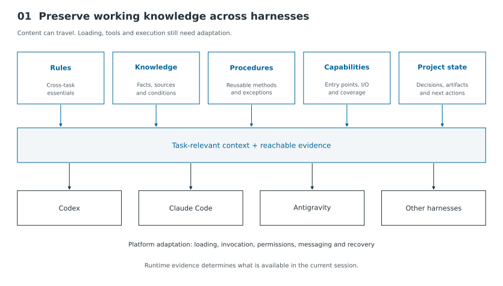
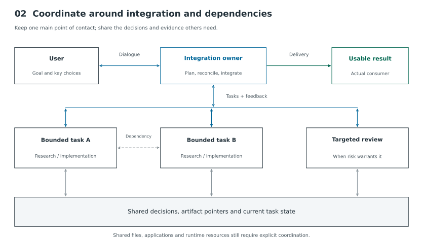
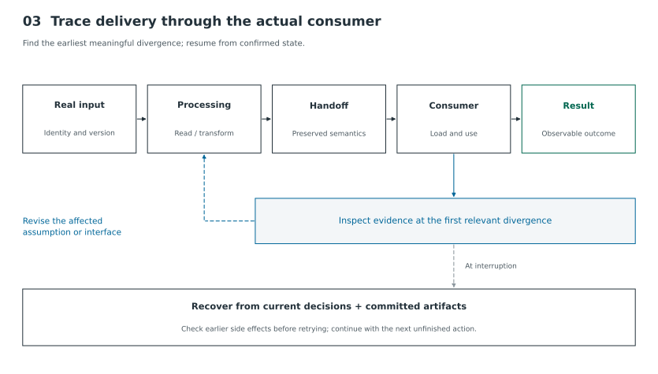

# 本地 Agent 工作流的组织与实践

**知识库、Skill、工具与项目记录，如何支撑长期任务、多 Agent 协作和跨环境接续。**

[English — full article](README.en.md) · [完整案例](docs/worked-example.zh-CN.md) · [参考资料](docs/references.md) · [图示与复现](figures/README.md)

当 AI 从一次性问答进入持续工作，问题会发生变化。模型仍然需要理解需求、作出判断，但项目开始依赖对话之外的信息：此前为什么选择这条路线，现有工具能完成哪一部分，其他成员交付了什么，以及哪些结果已经进入实际使用。

如果这些信息只保存在聊天里，用户就会逐渐承担项目协调的工作：补背景、转交任务、寻找产物、解释版本差异。增加 Agent 数量，有时反而增加了这部分负担。

本文介绍一套正在迭代的本地工作流，将可复用知识、操作方法、工具能力和项目状态分别管理，再围绕具体任务组织协作。相关做法已用于 UE 工程、游戏开发和工具开发等实践；研究、创作、学习与资料处理也可以按需采用其中的组织方式。不同场景的完成标准仍需分别确定。

文章重点是工作如何组织、信息如何维护、结果如何交接。案例经过抽象改写，不涉及内部项目、工具实现或私有资料。这是一份实践总结：公开研究用于比较设计选择，文中没有跨平台效率测量，也没有将尚未实现的自动调度列为现有能力。

## 1. 设计目标：减少持续工作中的信息断裂

一次对话通常可以依靠当前上下文完成任务。长期项目则不断跨越边界：从需求到实现，从一个成员到另一个成员，从本次会话到下次会话，从生成文件到下游使用。每次跨越都可能丢失信息。

这些丢失往往不是少了一段聊天，而是缺少会影响决策的内容。例如，接手者看到了当前方案，却不知道它依赖哪个输入版本；工具返回了空结果，却没有说明解析失败的部分；两个模块各自通过测试，集成时才发现它们对同一字段的理解不同。

因此，这套工作流主要解决三个问题：

- **工作依据可以找回。** 重要结论能够追溯到来源、输入或实际产物，摘要保留继续查证的路径。
- **责任与状态能够衔接。** 成员知道自己交付什么、交给谁；接手者知道哪些工作已经生效，哪些仍待完成。
- **已有能力能够继续使用。** 工具、方法和知识不依附于某次聊天，执行环境变化后仍能辨认和接入。

这些目标不要求所有任务采用相同流程。一个成员能够完成的小任务，直接完成即可；出现长期接续、共享修改或重复建设时，再增加相应记录和协作机制。流程的规模应与实际的信息损失和协调成本相称。[19](docs/references.md#s19)

## 2. 库的结构：按职责与更新方式分开管理

库体系的关键不是目录命名，而是让不同信息有明确的维护位置。主规则、领域知识、操作流程和项目状态的变化频率不同，混在一起会造成两种问题：临时结论逐渐变成永久要求，真正需要更新的信息却散落在多个副本里。

| 组成 | 负责保存的内容 | 典型更新原因 |
|---|---|---|
| 主规则 | 授权、隐私、事实表达、共享修改等跨任务要求 | 工作边界或长期协作原则发生变化 |
| 知识库 | 有出处的事实、格式与参数说明、适用条件、案例与失败原因 | 获得新证据，或版本变化使原结论需要修正 |
| Skill | 可重复采用的方法、关键判断和必要操作 | 方法被改进，或旧流程已不适用 |
| 工具登记 | 功能、调用入口、输入输出、依赖、支持范围与已知限制 | 工具新增、接口变化或现场能力与记录不符 |
| 项目台账 | 当前目标、决定、产物位置、未完成项与下一步 | 项目状态发生会影响接续的变化 |
| 项目工作区 | 实际实现、源文件、实验、运行数据与交付物 | 日常施工与实验 |

这些部分通过引用关联。例如，项目台账指向当前交付物，工具登记指向实现和调用说明，Skill 引用相关领域知识。共享正文只维护一处，其他入口提供必要说明与链接，避免相同内容在多个位置独立演化。

*图 1：库保存可持续维护的工作信息；当前会话按任务取用，执行环境负责实际加载和调用。*

信息也会随着使用发生转移。一次排错先保留在项目中；其中确认的格式特征可以进入知识库；反复有效的方法可以整理为 Skill；提取出的独立组件在工具登记中建立入口。原始实验仍留在项目，供需要时追溯。这样既能积累经验，也能避免把每次工作都变成全库整理。

库的规模扩大后，上下文选择同样重要。会话先读取相关入口和当前状态，需要时再展开原始证据。摘要用于导航，不能替代其所概括的资料。OpenAI 关于仓库知识的实践，以及 Anthropic 对上下文检索、压缩和外部记录的讨论，都为这种组织方式提供了参考。[1–3](docs/references.md#s01)

按需读取仍可能漏掉相关内容。入口应按用途提供足够的描述，并允许通过同义词、引用关系和代码检索继续查找。一次登记检索未命中，只说明当前检索没有找到，不能据此认定本地没有相应能力。

## 3. 从需求到方案：先确定使用目标，再选择实现

用户经常同时提出目标和一种初步方案，例如“让资料更容易检索，是否需要向量数据库”。其中，方便检索是使用目标，向量数据库是候选实现。Agent 需要区分两者，并结合现场条件判断方案是否合适。

有效的分析至少要解释一条完整关系：现有输入是什么，需要经过哪些处理，结果在哪里使用，哪些条件会影响实现选择。对于本地资料检索，文件类型、查询习惯、更新频率、原文定位和隐私要求，都可能比采用哪种数据库更早决定架构。

已有方案调查围绕这些选择展开。本地登记、目标软件的原生功能、公开库、文档和论文都可能提供可复用部分。评估候选时，需要核对实际输入输出、版本支持、下游接入方式与维护成本。必要时用代表性输入验证关键假设，调查足以支持决定后就开始施工。

复用不只有“整套采用”一种方式。可以直接调用成熟组件，也可以只使用其中的解析器、数据结构或交互方法。参考项目不适合当前目标时，应明确缺口，再选择适配、替换或自行实现。已有代码能节省多少工作，要连同其引入的约束一起计算。

检索也不必停留在关键词搜索。有价值的实现通常还连接着上游依赖、相关 issue、作者的其他工作和论文引用。沿这些关系继续调查，有助于找到不同命名下的同类能力。仓库的热度和作者的收藏只是线索，不能替代适用性判断。

方案形成后，只记录影响后续工作的内容：主要结构、共享接口、关键选择及原因、尚未验证的假设。简单修改可以直接体现在实现和说明里。用户对目标、授权和重大投入保留决定权；范围内可逆的技术选择由执行者推进，并随证据调整。

## 4. 多 Agent 协作：围绕依赖分工，明确集成责任

多 Agent 是否有收益，取决于任务能否分开推进，以及重新组合结果需要多少成本。独立检索、不同假设的排查、修改范围分离的实现，通常更容易并行；多人持续修改同一接口或共用一个有状态应用时，并行反而可能制造等待和返工。

复杂项目可以设置一个主要协调入口，对整体交付和集成负责。其职责是维护目标、关键依赖和共享决定，及时接入成员结果；具体实现细节留在相应任务和产物中。用户也可以直接与成员沟通，成员之间可针对真实依赖交换信息，重要变化再回写共享记录。

*图 2：集中维护目标与集成责任，按依赖分散探索和实现。成员数量与沟通关系均为示意。*

派发任务时，应让执行者能独立开工：提供目标、真实输入、允许修改的范围、预期产物、完成判断和交付位置。共享接口、隐私与预算等约束按实际需要补充。委派者的检索经历、样本和候选方法保留为依据，执行者可以用新证据修正它们。

协作形式也应随工作持续时间调整。子代理适合边界明确、可以回收结果的任务；长期模块可保留独立会话和工作区。两者都需要明确交付接收方，避免“成员完成”之后无人负责接入。

隔离文件修改只是其中一层。独立 worktree 可以分开代码变化，但数据库、索引、浏览器登录态、编辑器、GPU 和输出目录仍可能共享。需要检查这些资源是否支持并发；不能并发的部分由明确负责人或顺序安排处理。

外部案例支持这种按任务结构选择协作的思路。Anthropic 的研究系统与 Codex 子代理展示了任务分派和上下文分离的做法；MAST 和 Agent 系统扩展研究则讨论了协调、对齐与验证失效。研究任务中的收益不能直接外推到紧密耦合的工程，实际采用仍需观察自己的工作负载。[7–10](docs/references.md#s07)

## 5. 工具设计：结果可解释，失败可继续调查

工具适合承担确定性处理、重复操作、批处理和外部应用控制。选不选择工具化，要看它是否减少真实重复、隔离经常变化的接口，或降低重要错误的发生概率。模型已经能直接完成的一次性判断，通常没有必要再增加包装层。

对于已有能力，优先复用其可独立调用的部分。只有出现明确的集成收益时才增加适配接口。例如，一个稳定的解析核心可以同时供命令行和 MCP 使用；这不意味着需要把所有工具合并成统一平台。

工具返回值最需要解决的是含义不清。同样一个空结果，可能对应完全不同的情况：

| 实际情况 | 返回结果应让调用方知道什么 |
|---|---|
| 在已处理范围内没有匹配 | 本次处理与检索的范围，以及采用的条件 |
| 只处理了一部分输入 | 已覆盖部分、未覆盖原因及可继续检查的位置 |
| 执行失败 | 失败环节、必要诊断和底层错误 |
| 请求已提交，仍在执行 | 当前状态，以及查询结果或等待完成的方式 |
| 已生成输出 | 输出位置与版本；下游加载情况若未检查，应明确说明 |

这里列的是需要保留的区别，不要求所有工具使用同一返回格式。简单工具可以用清楚的文本；供程序批量处理的接口再提供相应结构化字段。

尤其要谨慎处理否定结论。解析器不支持某种格式、搜索根目录选错、数据尚未加载，都可能造成假阴性。Agent 应能检查原始输入、调用参数和错误，换用其他方法，必要时推翻工具对结果的解释。工具应增加可观察的信息，帮助模型判断其结论覆盖到哪里。

人和 Agent 尽量使用同一套功能语义：同样的输入范围、同样的选项含义、可以对应的输出。面向机器的接口可以更结构化，但不应悄悄改变操作本身的意义。

## 6. 交付与验证：从真实输入检查到实际使用

模块测试能够证明局部行为，完整使用过程还需要单独确认。一个转换器成功生成文件，下游程序可能仍因标识、编码、单位、坐标或时间语义不一致而错误使用。对文档、检索和创作任务，也存在类似问题：内容生成后，还需要确认读者或应用能否按预期使用。

因此，项目早期应选择一条覆盖关键新依赖的实际路径，尽快将输入、处理、交接和使用连接起来。这样可以在大规模生产前暴露接口和理解上的分歧。

*图 3：以实际使用结果检查整条路径。诊断可返回输入、处理、交接或使用端，恢复则先确认已生效的操作。*

当结果不正确时，沿依赖逐步比较，寻找最早出现的关键差异，再修正相关假设、数据或实现。重复运行最终步骤，通常无法修复上游的语义错误。

首条路径用于验证可行性，不代表整体目标已经完成。后续覆盖应选择能改变判断的差异：另一种输入、不同规模、更新后的数据、重新打开或中断恢复。是否需要独立审查、完整回归或人工观察，取决于后果与不确定性。

复用边界也通过这些变化检验。第二个对象可能只需要改数据，也可能揭示新的机制，需要新增适配或修改核心。通用设计应保留这些演进空间，避免为了维持“零代码修改”而隐藏特判。只有真实共用的行为，才值得提升为共享能力。

## 7. 跨环境接续：内容可以共用，执行需要适配

本文用 harness 指组织模型运行的软件层，包括上下文装配、工具调用、权限处理和执行循环。Codex、Claude Code、Antigravity 等提供不同的工作环境；它们的加载方式和运行机制需要分别确认。

跨环境复用可以分成两部分：

| 层次 | 可以保留的内容 | 更换环境时需要确认的部分 |
|---|---|---|
| 工作信息 | 目标、事实、方法、决定、接口说明与产物引用 | 当前版本是否可达，相关内容是否进入会话 |
| 执行机制 | 可复用的工具实现与协议适配 | 规则加载、工具接入、权限、会话控制、消息、等待与恢复 |

将项目依据保存在可读取的文本、文件和必要的结构化数据中，可以降低迁移成本。但内容迁移不等于执行连续：文件已同步，不代表新会话已加载；工具已登记，不代表当前环境已连接；消息接口存在，也不代表系统会自动跟进任务。

现有规范可以承担各自适合的部分。Agent Skills 为可复用方法提供文件组织规范，MCP 连接宿主与外部能力，ACP 提供客户端与编码 Agent 的通信接口。项目目标、共享修改责任和集成完成判断仍需在这些接口之上安排。[4–6](docs/references.md#s04)

基础设施层面的解耦还有更深的实现。例如，Managed Agents 将会话、harness 与执行环境分别管理。这与本文保存本地工作信息的思路相关，但处于不同层次，不能将内容可迁移表述为已经实现相同的运行隔离。[17](docs/references.md#s17)

实际接入时，应按当前能力缺口选择适配，而不预先建设覆盖所有客户端的抽象层。先让目标、产物和关键依据能够继续使用，再处理需要跨环境执行的具体操作。

## 8. 状态与调度：把可恢复记录和可靠执行分开实现

跨会话恢复首先依赖当前事实。接手记录通常只需说明目标与约束、已确认产物及版本、关键决定与原因、未解决问题和下一项动作。需要时再补工作区、运行环境和后台作业入口。

接手者先核对当前文件与实际运行状态。有矛盾时，只复核会影响下一步的关键前提。历史记录保留当时的输入和条件，新的决定明确替代哪部分内容，避免旧路线在换会话后重新出现。外部进度记录与长期任务接续的作用，也见于 Anthropic 的相关实践。[3](docs/references.md#s03)

自动调度则需要额外机制。任务已发送、已开始、已生成产物和已集成，分别对应不同事实。一次心跳只证明某个时间写过记录，不能证明进程仍在运行；消息发送成功也不能证明对方已处理。

对于需要持续派发的系统，任务标识、结果关联、可查询的执行状态和中断后的重试判断，都需要具体实现。特别是发布、导入或写入数据库等操作，连接超时后应先确认前一次操作是否已生效，再决定是否重试。持久化检查点并不自动提供外部操作只执行一次的保证。

Google ADK 的状态服务、LangGraph 的持久化和 Codex app-server 分别提供状态、检查点与执行接口；它们能减少基础设施工作，但采用哪一种取决于现有缺口。[11–13](docs/references.md#s11) Agent Orchestrator、Vibe Kanban 等现成项目也提供任务组织、工作区或会话控制能力，值得先评估，再决定是否自建。[14–15](docs/references.md#s14)

本地记录与可靠调度可以逐步建设。若当前主要问题是找不到最新产物，先改善记录就有价值；若用户仍在反复转发任务和追问进度，才需要进一步接入派发、等待与事件处理。把这两类需求分开，能避免用一套复杂平台解决原本只缺一个清晰入口的问题。

## 9. 维护与采用：根据实际收益增减流程

工作流会积累新的规则，也会积累过时的补偿措施。模型、工具与项目条件变化后，原本必要的步骤可能已无收益；局部事故形成的限制，也可能妨碍后来的工作。Anthropic 的后续 harness 实验说明，部分结构需要随模型能力重新评估。[16](docs/references.md#s16)

维护时可以围绕具体问题判断：这段规则防止哪类错误，当前条件下是否仍会发生；这篇 Skill 是否还有更新依据；这个工具入口是否可调用；这条项目记录是否能引导接手者继续。保留有效内容，修正失效部分，合并重复说明，不为统一格式重写全部资料。

验证也应服务当前决定。局部修改做相应检查；共享接口变化检查受影响路径；公开发布和高影响结论再增加独立核验。视觉、交互和表达质量需要向用户展示实际结果，让用户作出相应判断。Antigravity 的 artifacts 为可查看的计划与结果提供了一种实现参考，具体确认方式仍取决于工作环境。[18](docs/references.md#s18)

开始采用时，可以从一个反复需要补背景或转交结果的项目入手：让当前产物和下一步可找到，补齐最常复用的工具入口，再整理确实重复有效的方法。出现可独立推进的工作后再增加成员，出现持续派发需求后再增加调度机制。

是否值得继续，可以观察接手是否更顺利、人工转发是否减少、重复实现是否降低，以及结果能否更稳定地进入实际使用。这些是后续比较的方向，本文尚未对其给出量化结论。语义误解、过期记录、检索遗漏与共享应用状态仍是需要持续处理的问题。

## 延伸阅读与许可

- [完整案例：为本地资料浏览器增加搜索](docs/worked-example.zh-CN.md)
- [参考资料及采用范围](docs/references.md)
- [原创图示、文字说明与生成方法](figures/README.md)

文章、原创图示与本仓库原创示例采用 [CC BY 4.0](LICENSE)。第三方资料通过引用和链接提供，权利归各自权利人。许可不包含未公开的本地资料。本文为独立实践分享，不代表所提平台的官方立场。
